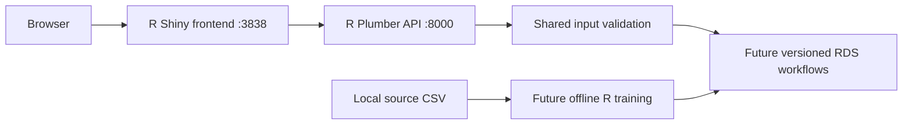

# Architecture

## Scope

A local, R-based application with two processes and no persistent user records.
The Shiny server makes HTTP requests to the Plumber API. The browser never needs API credentials or direct cross-origin access.

## Boundaries

- frontend/app.R defines navigation, a schema-driven vehicle form and observable request results.
- frontend/R/client.R wraps HTTP, timeouts and API-unavailable errors.
- shared/schema.R defines required features and validates scalar values, categories and ranges.
- backend/plumber.R defines HTTP routes; backend/R/services.R owns validation and the future inference boundary.
- backend/R/data.R reads the local CSV, normalizes source fields, audits missingness and excludes duplicate or invalid rows. The dashboard receives these records through the API; CSV uploads use a stateless preview route.
- scripts/ launch processes from the repository root. Raw data, preprocessing and model training never run during app startup.
- Data files and trained artifacts stay on disk. Submitted profiles live only in the current process/session and are not written to files or a database by application code.

The dashboard adds seven ggplot2 charts, session-specific reactive filters, KPI cards, a searchable/paginated DT table and CSV export. Charts describe observed records; no fitted trend or cluster assignment is implied. Source-level quality counts remain fixed when dashboard filters change.

## Current state

GET health/schema/status routes work independently of models. Valid inference requests receive 503 MODEL_NOT_TRAINED. Malformed JSON receives 400; valid JSON that violates the feature contract receives 422. The health route indicates process availability, not readiness to predict.

## Future model integration

Keep inference disabled until bundles, schema versions and category handling pass validation. Load trusted bundles once at API startup, reuse the training preprocessor and return a model version with outputs. Unknown categories require an explicitly trained fallback or an actionable validation error. Preserve original input values for display and normalize in saved preprocessing.

For segmentation, vehicle attributes determine groups; price is excluded from clustering inputs and used only for post hoc profiling. IDs are unstable across training runs, so version them and assign descriptive names only after interpreting centroids/medoids.

## Runtime and reproducibility

The two processes use configurable ports. API_BASE_URL belongs to the Shiny server environment. Default loopback bindings support local academic work. An internet deployment, authentication, rate controls and shared hosting are outside the structure phase.

DESCRIPTION declares runtime packages; scripts/setup.R installs missing runtime packages. Capture a reviewed renv.lock after the first verified R environment. Do not invent a lockfile without resolving actual dependency versions.
